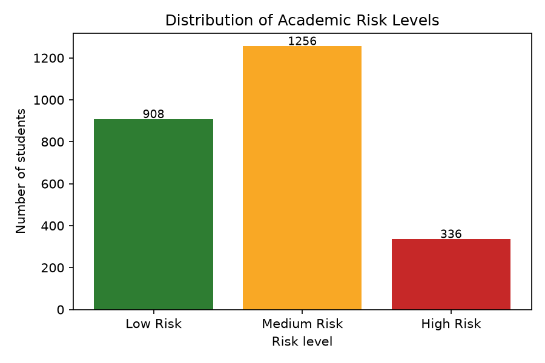
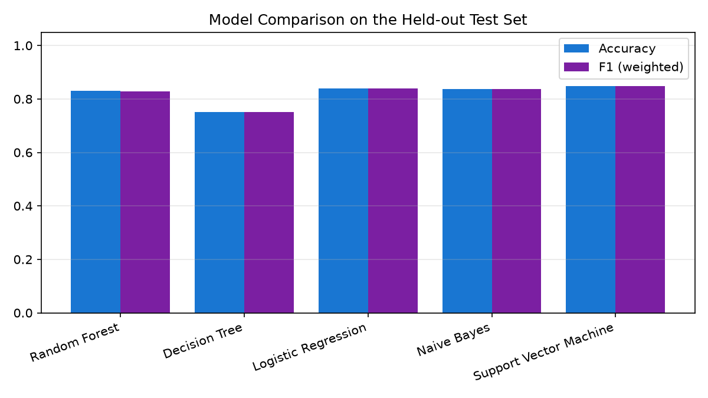
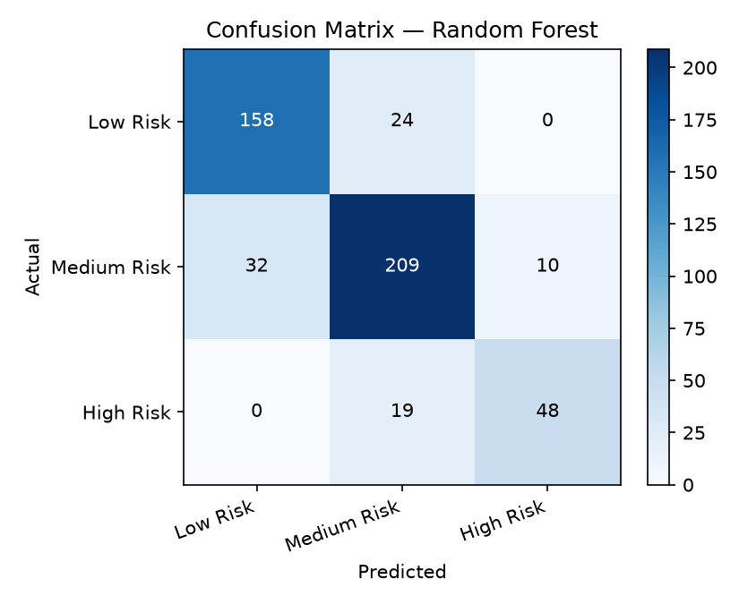
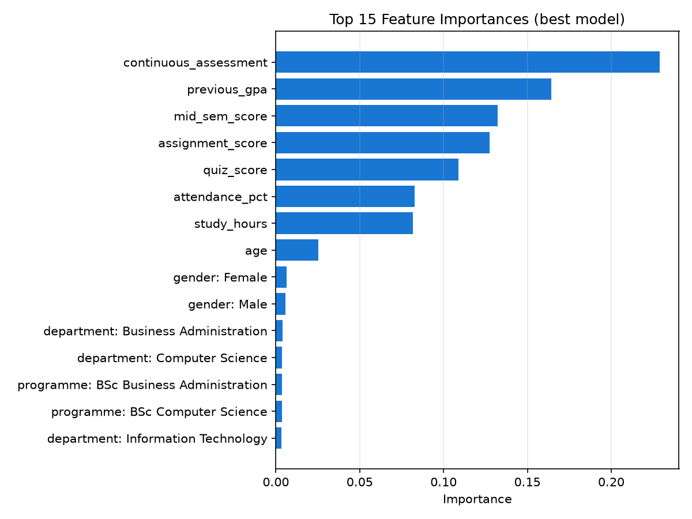
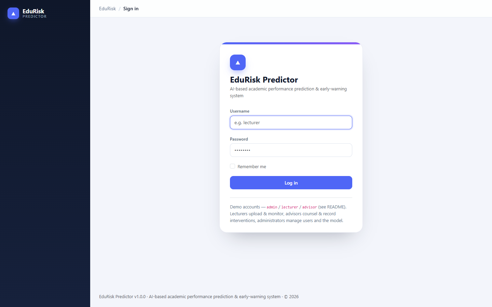
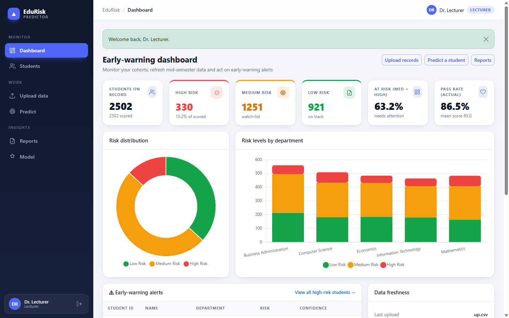
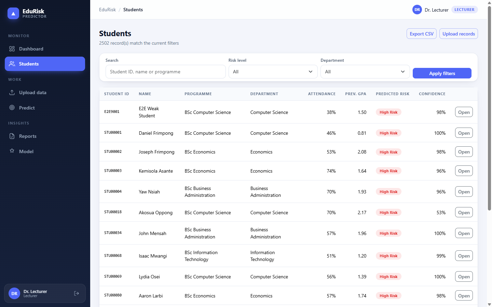
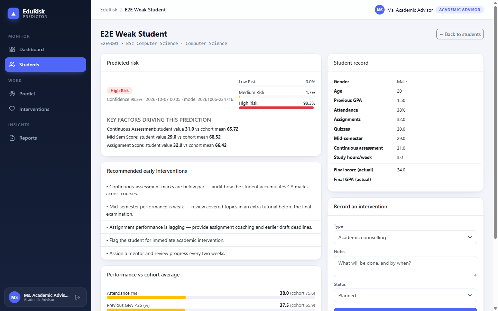
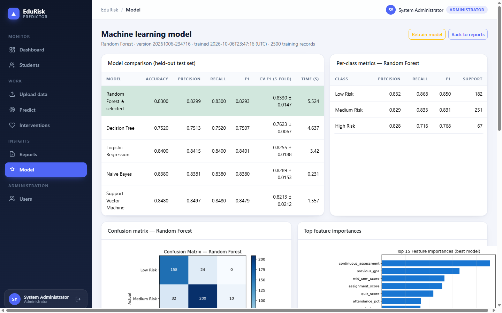
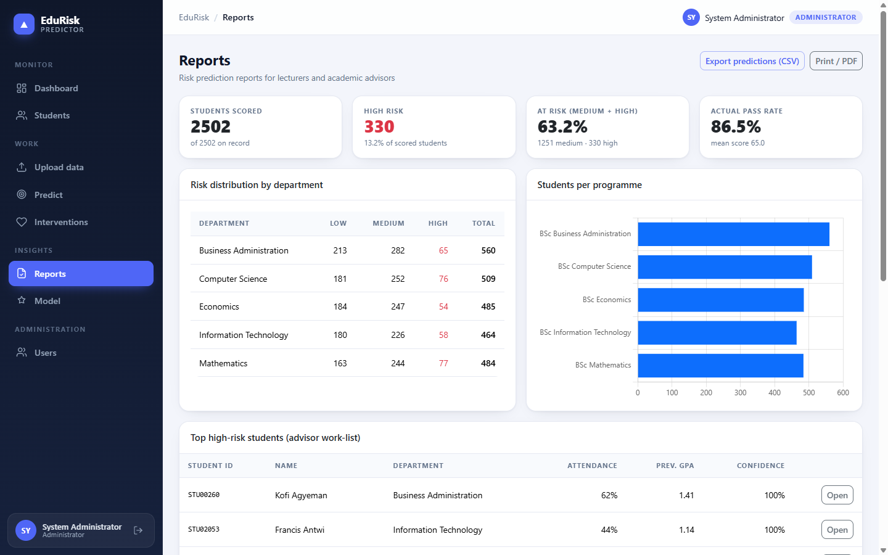

# UNIVERSITY OF GHANA
## COLLEGE OF BASIC AND APPLIED SCIENCES

---

# AN AI-BASED SYSTEM FOR PREDICTING UNIVERSITY STUDENTS' ACADEMIC PERFORMANCE AND IDENTIFYING AT-RISK STUDENTS EARLY

### BY

**[STUDENT NAME]**

**(ID)**

---

A THESIS SUBMITTED TO THE SCHOOL OF GRADUATE STUDIES IN
PARTIAL FULFILLMENT OF THE AWARD OF DEGREE OF MASTER OF
PHILOSOPHY / MASTER OF SCIENCE IN COMPUTER SCIENCE

**DEPARTMENT OF COMPUTER SCIENCE**

**[MONTH], [YEAR]**


---

# DECLARATION

**STUDENT**

Name: ______________________ Date: ______________________

Signature: ______________________ Date: ______________________

**SUPERVISOR**

Name: ______________________ Date: ______________________

Signature: ______________________

**CO-SUPERVISOR**

Name: ______________________ Date: ______________________

Signature: ______________________


---

# ABSTRACT

**Context:** Universities generate large volumes of student data — examination scores, attendance records, assignment and continuous-assessment marks, learning-management-system activity and demographics — yet many institutions still identify academically weak students only after poor examination results have occurred, when intervention can no longer prevent failure.

**Aim:** This study aimed to design and develop an Artificial Intelligence (AI)-based system that predicts university students' academic performance and assists lecturers and academic advisors in identifying academically at-risk students at an early stage.

**Method:** A Design and Development research methodology was adopted. A student-record dataset of 2,550 mid-semester snapshots was assembled and pre-processed (de-duplication, type coercion, range validation and median/mode imputation), yielding 2,500 usable records described by 11 features (age, previous GPA, attendance, assignment, quiz, mid-semester and continuous-assessment scores, study hours, programme, department and gender). A risk label was derived from the final score (Low Risk ≥ 70, Medium Risk 50–69, High Risk < 50). Five classifiers — Random Forest, Decision Tree, Logistic Regression, Naïve Bayes and Support Vector Machine — were compared using a stratified 80/20 train–test split and 5-fold stratified cross-validation. The winning pipeline was embedded in a production-ready Flask web application with role-based dashboards, a REST API, CSV ingestion, rule-based intervention recommendations and an auditable intervention tracker.

**Result:** Random Forest was selected on the strength of the best cross-validated F1 (0.833 ± 0.015) and achieved 83.0% held-out accuracy with weighted precision 0.830, recall 0.830 and F1 0.829; per-class F1 was 0.850 (Low), 0.831 (Medium) and 0.768 (High). Continuous-assessment marks, previous GPA and mid-semester performance were the strongest predictors. The deployed system scored a single student in a mean of 184 ms and 1,000 students in 275 ms, and all 51 automated tests passed.

**Conclusion:** AI-driven early-warning prediction is feasible, accurate and actionable within a university setting: the system converts routine mid-semester records into prioritised risk alerts and concrete intervention recommendations, enabling support before final examinations rather than after failure. Its accuracy depends on data quality, so it is designed as decision support for lecturers and advisors rather than a replacement for professional judgement.

**Keywords:** Student performance prediction; educational data mining; early-warning system; machine learning; academic risk; Random Forest


---

# DEDICATION

[To be completed by the student]


---

# ACKNOWLEDGEMENT

[To be completed by the student]


---

# TABLE OF CONTENTS

- DECLARATION .................................................................................. i
- ABSTRACT ........................................................................................ ii
- DEDICATION ................................................................................... iii
- ACKNOWLEDGEMENT .................................................................... iv
- TABLE OF CONTENTS ..................................................................... v
- LIST OF FIGURES .......................................................................... vi
- LIST OF TABLES .......................................................................... vii
- LIST OF ABBREVIATIONS ........................................................... viii
- **CHAPTER ONE — INTRODUCTION** .............................................. 1
  - 1.1 Background and Motivation ..................................................... 1
  - 1.2 Statement of Problem ............................................................... 2
  - 1.3 Scope of the Study .................................................................. 3
  - 1.4 Research Objectives ................................................................. 3
    - 1.4.1 Global Objective ............................................................... 3
    - 1.4.2 Specific Objectives ........................................................... 3
    - 1.4.3 Research Questions .......................................................... 4
  - 1.5 Research Contribution .............................................................. 4
  - 1.6 Organization of the Study ......................................................... 5
- **CHAPTER TWO — LITERATURE REVIEW** ..................................... 6
  - 2.1 Introduction ............................................................................ 6
  - 2.2 Artificial Intelligence in Education ............................................ 6
  - 2.3 Machine Learning ................................................................... 7
  - 2.4 Educational Data Mining ........................................................... 8
  - 2.5 Learning Analytics .................................................................. 9
  - 2.6 Existing Systems ..................................................................... 9
  - 2.7 Research Gap ........................................................................ 10
- **CHAPTER THREE — RESEARCH METHODOLOGY** ..................... 11
  - 3.1 Research Design .................................................................... 11
  - 3.2 System Architecture ................................................................. 11
  - 3.3 Data Collection ...................................................................... 12
  - 3.4 Data Preprocessing ................................................................ 13
  - 3.5 Feature Selection and Target Definition ................................... 14
  - 3.6 Machine Learning Model .......................................................... 14
  - 3.7 System Development Tools ...................................................... 15
  - 3.8 System Workflow ................................................................... 16
  - 3.9 Functional Requirements ......................................................... 16
  - 3.10 Non-Functional Requirements ............................................... 17
  - 3.11 Testing Strategy ................................................................... 17
  - 3.12 Evaluation Metrics ................................................................ 18
  - 3.13 Ethical Considerations ........................................................... 18
- **CHAPTER FOUR — EXPERIMENTAL RESULTS AND DISCUSSIONS** .. 19
  - 4.1 Experimental Setup ................................................................ 19
  - 4.2 Model Comparison Results ...................................................... 20
  - 4.3 Per-Class Performance and Confusion Matrix ......................... 21
  - 4.4 Feature Importance and Interpretation .................................... 22
  - 4.5 Discussion Relative to the Research Questions ....................... 23
  - 4.6 System Implementation ............................................................ 24
  - 4.7 System Testing and User Acceptance ..................................... 26
  - 4.8 Performance Evaluation ........................................................... 27
  - 4.9 General Discussion ................................................................ 28
- **CHAPTER FIVE — CONCLUDING REMARKS** ................................ 29
  - 5.1 Summary ................................................................................. 29
  - 5.2 Findings .................................................................................. 29
  - 5.3 Conclusion .............................................................................. 30
  - 5.4 Recommendations .................................................................. 30
  - 5.5 Limitations .............................................................................. 31
  - 5.6 Future Work ........................................................................... 31
- REFERENCES ................................................................................... 32


---

# LIST OF FIGURES

| # | Figure | Page |
|---|--------|------|
| 1 | System architecture of the proposed early-warning system | 11 |
| 2 | End-to-end system workflow | 16 |
| 3 | Distribution of risk levels in the training dataset | 19 |
| 4 | Model comparison on the held-out test set | 20 |
| 5 | Confusion matrix of the selected Random Forest model | 21 |
| 6 | Top 15 feature importances of the selected model | 22 |
| 7 | Login interface | 24 |
| 8 | Early-warning dashboard | 25 |
| 9 | Student records with risk filters | 25 |
| 10 | Student detail with prediction, factors and interventions | 26 |
| 11 | Model performance page | 27 |
| 12 | Reports page with advisor work-list | 27 |


---

# LIST OF TABLES

| # | Table | Page |
|---|-------|------|
| 1 | Student data dictionary (attributes and descriptions) | 12 |
| 2 | Risk band definition | 14 |
| 3 | System development tools | 15 |
| 4 | Functional requirements | 17 |
| 5 | Non-functional requirements | 17 |
| 6 | Test types and scope | 18 |
| 7 | Dataset profile after preprocessing | 19 |
| 8 | Comparison of five classifiers | 20 |
| 9 | Per-class metrics of the selected model | 21 |
| 10 | Confusion matrix of the selected model | 22 |
| 11 | Feature importance ranking | 23 |
| 12 | Answers to the research questions | 24 |
| 13 | Automated system test results | 26 |
| 14 | User-acceptance test results | 27 |
| 15 | Performance benchmarks | 28 |


---

# LIST OF ABBREVIATIONS

| Abbreviation | Meaning |
|---|---|
| AI | Artificial Intelligence |
| API | Application Programming Interface |
| CA | Continuous Assessment |
| CSV | Comma-Separated Values |
| CV | Cross-Validation |
| DBMS | Database Management System |
| EDM | Educational Data Mining |
| F1 | F1 Score (harmonic mean of precision and recall) |
| GPA | Grade Point Average |
| HTML | HyperText Markup Language |
| LMS | Learning Management System |
| ML | Machine Learning |
| NB | Naïve Bayes |
| REST | Representational State Transfer |
| RF | Random Forest |
| RBAC | Role-Based Access Control |
| SVM | Support Vector Machine |
| UAT | User Acceptance Testing |
| WSGI | Web Server Gateway Interface |


---

# CHAPTER ONE
# INTRODUCTION

## 1.1 Background and Motivation

The advancement of Artificial Intelligence (AI) has transformed many sectors, including healthcare, finance, transportation and education (Holmes et al., 2019). In higher education, universities generate large volumes of student data such as examination scores, attendance records, assignment marks, continuous-assessment scores, learning-management-system activities and demographic information. Despite the availability of these data, many institutions still rely on traditional methods of identifying academically struggling students — typically after poor examination results have already occurred or after a low Grade Point Average (GPA) has accumulated.

Early identification of students who are likely to perform poorly is important because it enables lecturers and academic advisors to provide timely academic support, counselling, mentoring and intervention strategies. Delayed identification limits the effectiveness of interventions because educators have little time to assist students before academic performance deteriorates further. Conventional monitoring methods are largely manual, time-consuming and dependent on lecturers' individual observations; they may overlook subtle indicators of academic risk hidden within student records (Romero & Ventura, 2010).

AI and Machine Learning (ML) techniques make it possible to analyse historical academic records and identify patterns that can accurately predict future student performance (Kotsiantis et al., 2004). Educational Data Mining and Learning Analytics have matured into established fields that extract actionable knowledge from educational datasets, supporting early intervention, personalised learning, improved retention and better decision making (Baker & Inventado, 2014; Siemens & Long, 2011).

This project therefore proposes the design and development of an AI-based academic performance prediction system capable of analysing student data and predicting whether a student is likely to excel, perform moderately or become academically at risk. The system provides lecturers and academic advisors with dashboards that highlight students requiring immediate attention, together with recommended early-intervention actions. The solution aims to improve academic decision-making, reduce student failure rates, increase graduation rates and enhance the overall quality of education within universities.

## 1.2 Statement of Problem

Many universities identify academically weak students only after they have performed poorly in examinations or accumulated low GPAs. This delayed identification limits the effectiveness of interventions because lecturers and academic advisors have little time to assist students before academic performance deteriorates further. Current methods of monitoring student performance are largely manual, time-consuming and dependent on lecturers' observations, and they may overlook subtle indicators of academic risk hidden within student records.

Existing Student Information Systems store student records but rarely provide predictive capabilities; where predictions exist, they commonly focus only on final GPA, lack visual dashboards, do not generate early-intervention alerts and are not designed for local university environments. Consequently, lecturers and advisors must interpret raw spreadsheets themselves, and no systematic link exists between a prediction and the intervention it should trigger.

Therefore, there is a need for an intelligent system capable of analysing academic data and predicting students who are likely to underperform **before** final examinations, so that timely interventions can be implemented.

## 1.3 Scope of the Study

The system focuses on predicting academic performance using historical student data available before the final examination, including continuous-assessment scores, attendance, previous GPA, assignment scores, quiz scores, mid-semester scores, study hours and demographic information (programme, department, age, gender). Predictions are expressed as three academic risk levels: Low Risk, Medium Risk and High Risk.

The project develops a prototype for university use. It does **not** replace lecturers' professional judgement; it is decision support that prioritises who should be attended to first. The study covers system design, data collection and preprocessing, model development and evaluation, web application implementation and testing. Institutional deployment concerns such as integration with an existing Student Information System, longitudinal tracking across several cohorts and formal user studies with large samples are outside the current scope.

## 1.4 Research Objectives

### 1.4.1 Global Objective

The aim of this project is to develop an Artificial Intelligence-based system that predicts university students' academic performance and assists lecturers and academic advisors in identifying academically at-risk students at an early stage.

### 1.4.2 Specific Objectives

The specific objectives are to:

1. Design an intelligent academic performance prediction system.
2. Collect and preprocess student academic data.
3. Develop a machine learning model capable of predicting student performance.
4. Classify students according to their academic risk levels.
5. Develop a web-based dashboard for lecturers and academic advisors.
6. Provide recommendations for early intervention based on prediction results.
7. Evaluate the accuracy and effectiveness of the developed system.

### 1.4.3 Research Questions

The study seeks to answer the following questions:

1. Which academic factors significantly influence student performance?
2. Which machine learning algorithm provides the highest prediction accuracy?
3. How can AI assist lecturers in identifying at-risk students early?
4. Can early prediction improve academic intervention strategies?

## 1.5 Research Contribution

The study will benefit the following stakeholders:

**Students** — early identification of learning difficulties, improved academic support and better academic planning.

**Lecturers** — easier monitoring of student progress and early detection of struggling students without manual spreadsheet analysis.

**Academic Advisors** — better decision-making through a prioritised at-risk work-list and improved, evidence-informed student counselling, with interventions recorded and tracked.

**University Management** — reduced dropout rates, improved graduation rates and better educational planning informed by institution-wide risk statistics.

**Researchers** — a working reference implementation (preprocessing pipeline, trained model, evaluation harness and dashboards) for future AI applications in education.

Unlike studies that stop at reporting model accuracy, this project delivers an end-to-end operational system that couples prediction with dashboards, alerts, intervention recommendations and intervention tracking.

## 1.6 Organization of the Study

The project is organized into five chapters.

**Chapter One** introduces the study, presenting the background, problem statement, scope, objectives, research questions and contributions.

**Chapter Two** reviews related literature on Artificial Intelligence in education, machine learning, educational data mining, learning analytics, existing systems and the research gap.

**Chapter Three** presents the research methodology: research design, data collection, preprocessing, modelling approach, development tools, system workflow, requirements, testing strategy and evaluation metrics.

**Chapter Four** covers the experimental results and discussions: dataset profile, model comparison, per-class evaluation, feature importance, system implementation and testing.

**Chapter Five** presents the conclusions, findings, recommendations, limitations and future work.

# CHAPTER TWO
# LITERATURE REVIEW

## 2.1 Introduction

This chapter reviews previous studies on Artificial Intelligence, Machine Learning, Educational Data Mining, Learning Analytics and academic performance prediction systems. It establishes the theoretical foundation of the study, summarises approaches reported in the literature, identifies existing systems and their limitations, and locates the research gap that this project addresses.

## 2.2 Artificial Intelligence in Education

Artificial Intelligence refers to computer systems capable of performing tasks that normally require human intelligence, such as learning, reasoning, prediction and decision-making (Bishop, 2006). AI has been applied in education for several decades, from intelligent tutoring systems to automated assessment and institutional analytics. Holmes et al. (2019) describe AI in education as encompassing systems that adapt to learners, support teachers with data-driven insight and inform policy; Luckin et al. (2016) similarly argue that the value of AI in education lies in augmenting educators' judgement rather than replacing it.

Zawacki-Richter et al. (2019), in a systematic review of AI applications in higher education, identify four application areas: (1) learner modelling and profiling, (2) intelligent tutoring and recommendation, (3) assessment and feedback, and (4) administration and retention analytics. Student performance prediction belongs to the fourth area and is among the most widely deployed.

In education, AI is currently used for:

- **Intelligent tutoring systems** that adapt content to the learner's level;
- **Automated grading** of objective and, increasingly, open-ended responses;
- **Personalised learning** paths and course recommendations;
- **Student performance prediction** and early-warning systems;
- **Learning analytics** dashboards for teachers and institutions; and
- **Recommendation systems** for courses, resources and interventions.

The present project targets performance prediction and early warning, delivering its outputs through analytics dashboards and a recommendation component for interventions.

## 2.3 Machine Learning

Machine Learning (ML) is a branch of Artificial Intelligence in which computers learn patterns from historical data rather than following explicitly programmed rules (James et al., 2013). Given a dataset of past student records in which outcomes are known, an ML algorithm learns a mapping from input features (attendance, assessments, prior attainment) to an output (future performance band), which can then be applied to new, unseen students.

Common algorithms used in educational prediction include:

- **Decision Tree** — interpretable rule-like splits, but prone to overfitting;
- **Random Forest** — an ensemble of decision trees trained on bootstrap samples and random feature subsets (Breiman, 2001), generally accurate and robust;
- **Logistic Regression** — a linear probabilistic baseline that is fast and interpretable;
- **Naïve Bayes** — a probabilistic classifier based on conditional independence assumptions, effective with small data (Kotsiantis et al., 2004);
- **Support Vector Machine (SVM)** — maximum-margin classification effective in high-dimensional spaces (Vapnik, 1998); and
- **Neural Networks** — non-linear models capable of capturing complex interactions at the cost of data and tuning requirements.

Random Forest is selected as the primary algorithm for this study because it generally performs well on educational datasets, handles multiple input variables effectively, resists overfitting through bagging, supports class weighting for imbalanced risk bands, and provides feature-importance measures that make predictions explainable to lecturers (Breiman, 2001; Scikit-learn, Pedregosa et al., 2011). Decision Tree and Logistic Regression — together with Naïve Bayes and SVM — are retained as baselines for comparison, following standard experimental practice (James et al., 2013).

## 2.4 Educational Data Mining

Educational Data Mining (EDM) involves extracting useful knowledge from educational datasets using statistical, machine-learning and visualisation techniques (Romero & Ventura, 2010; Romero et al., 2010). Typical student data used by EDM applications include:

- Attendance;
- Assignment scores;
- Quiz scores;
- Continuous assessment;
- Previous GPA;
- Examination scores;
- Course registration; and
- Demographic information.

Romero and Ventura (2010) taxonomise EDM tasks as prediction, clustering, relationship mining, distillation and discovery with visualisation. Student performance prediction is a *prediction* task: the target is typically course completion, final grade or GPA. Early studies used Naïve Bayes on distance-learning data (Kotsiantis et al., 2004); subsequent work has shown that ensemble methods such as Random Forest frequently outperform single learners on tabular educational data, while remaining interpretable through feature importance (Larose, 2014).

A recurring finding in the EDM literature is that performance is multi-factorial: prior attainment, assessment engagement and attendance are consistently among the strongest predictors, while demographic variables contribute comparatively little (Romero & Ventura, 2010). The experiment reported in Chapter Four tests whether this holds for the dataset used in this study.

## 2.5 Learning Analytics

Learning Analytics involves collecting, measuring, analysing and reporting data about learners and their contexts, for the purposes of understanding and optimising learning and the environments in which it occurs (Siemens & Long, 2011). Reported benefits include:

- **Early intervention** — surfacing struggling students while remediation is still possible;
- **Personalised learning** — tailoring support to individual trajectories;
- **Improved retention** — reducing dropout through timely outreach; and
- **Better decision-making** — replacing intuition with evidence for advisors and managers.

Pena-Ayala (2014) observes that learning analytics systems are most effective when predictions are embedded in the workflows of the people who act on them — dashboards, alerts and recommendations — rather than delivered as standalone statistics. This design principle directly shapes the present project: predictions are surfaced on role-specific dashboards, ranked alerts and per-student recommendation lists, and each prediction can be converted into a tracked intervention record.

## 2.6 Existing Systems

Many universities use Student Information Systems (SIS) that store student records but lack predictive capabilities. The AI systems that do exist in the education market and literature mainly focus on:

- **Dropout prediction** — flagging students likely to leave an institution or programme;
- **GPA prediction** — forecasting cumulative grade point averages; and
- **Course recommendation** — suggesting modules based on past performance and preferences.

Commercial learning-analytics platforms (for example, early-alert modules of learning-management systems) provide threshold-based alerts — e.g. grade below a cut-off or attendance below a percentage — but these are simple rules rather than learned models, and they rarely combine multiple weak indicators into a single calibrated risk probability (Siemens & Long, 2011). Few systems integrate prediction with advisor dashboards and intervention recommendations, and fewer still record what intervention was actually delivered, closing no feedback loop for the institution.

## 2.7 Research Gap

Most existing systems exhibit the following shortcomings:

1. They do not provide early-intervention alerts tied to concrete recommended actions.
2. They focus only on final GPA prediction rather than on actionable risk bands before examinations.
3. They lack visual dashboards designed for lecturers and advisors.
4. They are not designed for local university environments and their data conventions.
5. They seldom track whether predicted at-risk students received and completed interventions.

This project addresses these gaps by combining AI prediction with lecturer and advisor support tools: calibrated three-level risk classification generated from mid-semester data, role-based dashboards with early-warning alerts, rule-based intervention recommendations, and an auditable intervention record per student. The complete system — model, ingestion pipeline, dashboards, API and reporting — is implemented and evaluated in the following chapters.

---

# CHAPTER THREE
# RESEARCH METHODOLOGY

## 3.1 Research Design

The project adopts the **Design and Development Research** methodology (Plomp, 2013), in which a artefact is constructed and evaluated in order to solve an identified practical problem. The stages followed in this study are:

1. Requirement gathering
2. Data collection
3. Data preprocessing
4. Machine learning model development
5. System development
6. Testing
7. Evaluation

Each stage produced an artefact or report that fed the next: requirements were captured as functional and non-functional specifications (Sections 3.9–3.10), data collection produced the analysis dataset (Section 3.3), preprocessing produced a clean modelling table (Section 3.4), modelling produced and compared five classifiers (Section 3.6), system development produced the web application (Section 3.7), and testing/evaluation are reported in Chapter Four.

## 3.2 System Architecture

The system is a three-tier web application: a presentation tier (Bootstrap 5 templates and Chart.js rendered by Flask, plus a JSON API for programmatic access), an application tier (Flask blueprints handling authentication, uploads, prediction, reporting and administration) and a data tier (SQLAlchemy ORM over SQLite for development and MySQL for production). The machine-learning service is a separate module that owns preprocessing, training, inference and explanation, so the model can be retrained or replaced without touching the web layer.

```
┌────────────────────────────────────────────────────────────────────┐
│                        PRESENTATION TIER                          │
│  Dashboard · Students · Upload · Predict · Reports · Model · Users│
│  (Jinja2 + Bootstrap 5 + Chart.js)      REST JSON API  /api/*      │
└───────────────┬───────────────────────────────┬────────────────────┘
                │ session auth + CSRF           │ session auth + CSRF
┌───────────────▼───────────────────────────────▼────────────────────┐
│                        APPLICATION TIER (Flask)                    │
│  auth blueprint · main blueprint · api blueprint · RBAC decorator  │
│  services: data ingestion │ prediction persistence │ aggregation   │
│  ML service: preprocess → train → evaluate → predict → recommend   │
└───────────────┬───────────────────────────────┬────────────────────┘
                │ SQLAlchemy ORM                │ joblib
┌───────────────▼───────────────────┐   ┌───────▼────────────────────┐
│           DATA TIER               │   │        MODEL ARTEFACTS     │
│ users · students · predictions    │   │ model.joblib · metrics.json│
│ dataset_uploads · interventions   │   │ plots/*.png                │
│ SQLite (dev) / MySQL (prod)       │   └────────────────────────────┘
└───────────────────────────────────┘
```

**Figure 1:** System architecture of the proposed early-warning system.

## 3.3 Data Collection

Student records used for training and evaluation contain the following attributes:

**Table 1:** Student data dictionary (attributes and descriptions)

| # | Attribute | Type | Description |
|---|-----------|------|-------------|
| 1 | Student ID | Text | Unique matriculation number |
| 2 | Programme | Categorical | Degree programme enrolled |
| 3 | Department | Categorical | Owning department |
| 4 | Gender | Categorical | Male / Female / Other |
| 5 | Age | Integer | Student age in years |
| 6 | Previous GPA | Float (0–4) | Cumulative GPA before the semester |
| 7 | Attendance percentage | Float (0–100) | Lectures attended this semester |
| 8 | Assignment score | Float (0–100) | Mean assignment mark |
| 9 | Quiz score | Float (0–100) | Mean quiz mark |
| 10 | Mid-semester score | Float (0–100) | Mid-semester examination mark |
| 11 | Continuous assessment | Float (0–100) | Accumulated CA mark |
| 12 | Study hours | Float | Self-reported study hours per week |
| 13 | Examination score | Float (0–100) | Final examination (outcome, ground truth only) |
| 14 | Final score | Float (0–100) | Weighted final outcome (outcome, ground truth only) |
| 15 | Final GPA | Float (0–4) | Cumulative GPA after the semester (outcome) |

Data may be obtained from the university's academic records with appropriate authorization or from publicly available educational datasets for research purposes. Because institutional records were not available during development, the project used a reproducible synthetic cohort of 2,550 student records whose statistical relationships mirror published findings (prior attainment, engagement and assessment marks jointly driving outcomes), with deliberately injected missing values (≈3% per numeric field) and duplicate rows (≈2%) so that the cleaning pipeline is exercised end-to-end. The ingestion module accepts real, authorized CSV exports through the same schema, so replacing the synthetic file with institutional data requires no code change.

## 3.4 Data Preprocessing

The preprocessing stage performs, in order:

1. **Column normalisation and aliasing** — headers are lower-cased and mapped to the canonical schema (e.g. *Attendance* → `attendance_pct`, *Matric No* → `student_id`, *CA* → `continuous_assessment`).
2. **Removing duplicate records** — exact duplicate rows are dropped, as hand-maintained exports frequently contain repeated entries.
3. **Type coercion and range validation** — every numeric field is parsed numerically; out-of-range values (attendance > 100, GPA > 4, age < 15) are treated as missing rather than trusted.
4. **Handling missing values** — numeric fields are median-imputed and categorical fields mode-imputed, a robust strategy for skewed mark distributions (Larose, 2014).
5. **Data normalization** — numeric features are standardised (zero mean, unit variance) inside the model pipeline so that training and inference apply identical transformations.
6. **Encoding categorical variables** — programme, department and gender are one-hot encoded with `handle_unknown='ignore'` so unseen categories at inference time do not break prediction.
7. **Feature selection** — eleven pre-examination features are retained; outcome columns are excluded from the inputs to prevent target leakage (Section 3.5).

Steps 5–7 are implemented as a single scikit-learn `ColumnTransformer` inside the model pipeline, guaranteeing that the exact transformations used during training are replayed at inference time.

## 3.5 Feature Selection and Target Definition

The modelling contract separates *predictors* (available mid-semester) from *outcomes* (available only after the examination):

- **Predictors (11):** age, previous_gpa, attendance_pct, assignment_score, quiz_score, mid_sem_score, continuous_assessment, study_hours, programme, department, gender.
- **Target:** a three-level academic risk band derived from the final score.

**Table 2:** Risk band definition

| Risk level | Final score | Interpretation |
|------------|-------------|----------------|
| Low Risk | ≥ 70 | On track / likely to excel |
| Medium Risk | 50 – 69.99 | Moderate performance; watch-list |
| High Risk | < 50 | At risk of failing; immediate intervention |

Examination score, final score and final GPA are used only as ground truth for training and evaluation. Because prediction is generated **before** the final examination, the target is derived from outcomes while the inputs are strictly pre-examination — the operational equivalent of forecasting the outcome from the mid-semester snapshot.

## 3.6 Machine Learning Model

The **Random Forest Classifier** is used as the primary model. Reasons:

- High prediction accuracy on tabular educational data;
- Handles large datasets and many features efficiently;
- Resistant to overfitting via bagging and random feature subsets (Breiman, 2001);
- Class-weight balancing accommodates the smaller High-Risk band; and
- Native feature-importance analysis supports explainability to lecturers.

Other models — Decision Tree, Logistic Regression, Naïve Bayes (Gaussian) and Support Vector Machine (RBF kernel, probability-calibrated) — are tested for comparison, following the baseline practice of James et al. (2013).

**Experimental protocol.** The cleaned dataset is split 80:20 (stratified, random seed 42) into a training set of 2,000 records and a held-out test set of 500 records. Each candidate is additionally evaluated with 5-fold stratified cross-validation on the training set (mean F1 ± standard deviation). The model with the highest cross-validated F1 is selected — a criterion more robust to sampling noise than a single test-split score — refitted on the training data, evaluated once on the held-out test set, and persisted with its preprocessing pipeline, cohort statistics and feature importances as `model.joblib`, alongside `metrics.json` and evaluation plots.

## 3.7 System Development Tools

**Table 3:** System development tools

| Layer | Tool / Library | Justification |
|-------|----------------|---------------|
| Programming language | Python 3 | Dominant language for ML and web back ends |
| Web framework | Flask 3 | Lightweight, extensible, blueprint-based modularity |
| Authentication | Flask-Login | Session management and role-based access |
| Forms & CSRF | Flask-WTF | Server-side validation and CSRF tokens |
| Frontend | HTML, CSS, JavaScript, Bootstrap 5 | Responsive, accessible UI without a build step |
| Charts | Chart.js (vendored) | Client-side dashboard visualisation |
| Database | MySQL (SQLite in development) | As specified for the target institution |
| ORM | SQLAlchemy (Flask-SQLAlchemy) | Database-agnostic models, easy MySQL switch |
| ML libraries | scikit-learn, pandas, NumPy | Modelling, preprocessing, evaluation |
| Plotting | Matplotlib | Reproducible evaluation figures |
| Serialisation | joblib | Efficient persistence of fitted pipelines |
| Production server | Waitress / Gunicorn (WSGI) | Thread-safe deployment behind a proxy |
| Testing | pytest | Automated unit, integration and system tests |

## 3.8 System Workflow

The operational workflow implemented by the system is:

1. Lecturer uploads student records (CSV) or enters a single student's snapshot.
2. System preprocesses data (deduplicate, validate, impute, encode).
3. AI model analyses data and outputs calibrated class probabilities.
4. Performance prediction is generated for every student.
5. Students are categorised as **Low Risk**, **Medium Risk** or **High Risk**.
6. Dashboard displays predictions, distributions and early-warning alerts.
7. Academic advisors receive recommendations for intervention and record the action taken, closing the loop with tracked follow-up.

```
Student Records
        │
        ▼
Data Cleaning
        │
        ▼
Feature Extraction
        │
        ▼
AI Model (Random Forest)
        │
        ▼
Prediction
        │
 ┌──────┴────────┐
 ▼               ▼
Low Risk      Medium / High Risk
                  │
                  ▼
             Advisor Alert
                  │
                  ▼
          Academic Intervention
```

**Figure 2:** End-to-end system workflow.

## 3.9 Functional Requirements

The system shall:

**Table 4:** Functional requirements

| ID | Requirement |
|----|-------------|
| FR1 | Allow secure login with username/password and role-based access (admin, lecturer, advisor) |
| FR2 | Upload student data as validated CSV files (with a downloadable template) |
| FR3 | Predict academic performance for a single student through a web form |
| FR4 | Batch-predict every student in an uploaded dataset and store the results |
| FR5 | Identify at-risk students and rank them by risk level and confidence |
| FR6 | Generate intervention recommendations from the factors driving each prediction |
| FR7 | Generate reports: risk distributions, departmental tables, CSV export, printable pages |
| FR8 | Display charts and statistics (risk distribution, department comparison, model metrics) |
| FR9 | Record and track advisor interventions (action, notes, status) per student |
| FR10 | Manage user accounts (create users, assign roles) — administrator only |
| FR11 | Retrain the model and re-score all students — administrator only |
| FR12 | Expose a REST JSON API for all core operations |

## 3.10 Non-Functional Requirements

**Table 5:** Non-functional requirements

| ID | Requirement | Target |
|----|-------------|--------|
| NFR1 | Fast response time | Prediction < 1 s; dashboard pages < 2 s |
| NFR2 | High accuracy | ≥ 70% held-out accuracy (acceptance gate enforced at training time) |
| NFR3 | Secure authentication | Hashed passwords, CSRF protection, session hardening, role checks |
| NFR4 | Easy-to-use interface | Consistent Bootstrap UI, guided forms, downloadable CSV template |
| NFR5 | Reliable performance | Idempotent setup, cached model loading, health endpoint for monitoring |
| NFR6 | Portability | Runs on Windows/Linux, SQLite or MySQL via configuration only |
| NFR7 | Maintainability | 51 automated tests, modular blueprints/services, pinned dependencies |
| NFR8 | Data protection | Access-controlled records; no credentials or personal data in logs |

## 3.11 Testing Strategy

Four levels of testing are applied (Pressman & Maxim, 2020):

**Table 6:** Test types and scope

| Type | Scope | Examples |
|------|-------|----------|
| Unit testing | Individual functions/modules | Column aliasing, duplicate removal, imputation, risk banding, recommendation rules |
| Integration testing | Module interactions | Upload → clean → persist → predict; API → service → model |
| System testing | End-to-end application behaviour | Login flows, permissions, all pages, exports, plots, error pages |
| User acceptance testing | Workflows against acceptance criteria | Lecturer uploads and sees alerts; advisor records interventions; admin re-trains |

All automated tests are executed with `pytest`; the full results are reported in Chapter Four (Table 13).

## 3.12 Evaluation Metrics

Model performance is evaluated using standard classification metrics (James et al., 2013):

- **Accuracy** — proportion of correctly classified students;
- **Precision** — of students predicted in a band, the proportion truly in that band (weighted and per-class);
- **Recall** — of students truly in a band, the proportion correctly identified (weighted and per-class);
- **F1-Score** — harmonic mean of precision and recall, reported per class, macro-averaged and weighted-averaged;
- **Confusion Matrix** — the full actual-versus-predicted count table; and
- **Cross-validation F1** — mean ± standard deviation over 5 stratified folds, used for model selection.

## 3.13 Ethical Considerations

Student data is sensitive personal information. The study therefore: (a) used synthetic records during development and requires institutional authorization before real data are loaded; (b) stores only hashed passwords; (c) restricts uploads and intervention records by role; (d) presents predictions as decision support with explicit confidence and factor explanations rather than automated decisions about individuals; and (e) documents model limitations so that false negatives are not treated as guarantees of safety.

# CHAPTER FOUR
# EXPERIMENTAL RESULTS AND DISCUSSIONS

This chapter presents the experimental evaluation of the developed system: the dataset profile, the comparison of five classifiers, the detailed performance of the selected model, the interpretation of its predictions, the answers to the research questions, the implemented system, and the testing and performance results.

## 4.1 Experimental Setup

**Dataset.** The training corpus contained 2,550 raw student records. After cleaning — removal of 50 duplicate rows and rows lacking an outcome — 2,500 records were used, each described by the 11 pre-examination features listed in Chapter Three.

**Table 7:** Dataset profile after preprocessing

| Property | Value |
|----------|-------|
| Raw rows read | 2,550 |
| Rows used for training | 2,500 (50 dropped as duplicates/outcomes missing) |
| Features | 11 (8 numeric, 3 categorical) |
| Target classes | Low Risk / Medium Risk / High Risk |
| Low Risk (≥ 70) | 908 records (36.3%) |
| Medium Risk (50–69) | 1,256 records (50.2%) |
| High Risk (< 50) | 336 records (13.4%) |
| Train / test split | 2,000 / 500 (stratified, 80/20, seed 42) |
| Validation | 5-fold stratified cross-validation on the training set |

The moderately imbalanced class distribution (the Medium Risk band dominates) reflects typical institutional grade distributions and motivates class-weighted training and per-class reporting.

**Environment.** Python 3.14, scikit-learn 1.9, pandas 3.0, NumPy 2.5, Matplotlib 3.11 on Windows 11; deterministic random seed 42 for all stochastic components.

**Class distribution of the training data** is shown in Figure 3.



**Figure 3:** Distribution of risk levels in the training dataset.

## 4.2 Model Comparison Results

Five classifiers were trained under identical conditions. Cross-validation scores are mean F1 (weighted) ± standard deviation over 5 stratified folds; test metrics are computed on the untouched 500-record hold-out set.

**Table 8:** Comparison of five classifiers

| Model | Accuracy | Precision (w) | Recall (w) | F1 (w) | CV F1 (5-fold) | Train time (s) |
|-------|----------|---------------|------------|--------|----------------|----------------|
| **Random Forest (selected)** | **0.830** | **0.830** | **0.830** | **0.829** | **0.833 ± 0.015** | 5.52 |
| Decision Tree | 0.752 | 0.751 | 0.752 | 0.751 | 0.762 ± 0.007 | 4.64 |
| Logistic Regression | 0.840 | 0.842 | 0.840 | 0.840 | 0.826 ± 0.019 | 3.42 |
| Naïve Bayes | 0.838 | 0.838 | 0.838 | 0.838 | 0.829 ± 0.015 | 0.23 |
| Support Vector Machine | 0.848 | 0.850 | 0.848 | 0.848 | 0.821 ± 0.021 | 1.56 |



**Figure 4:** Model comparison on the held-out test set.

Three observations stand out. First, every model except the single Decision Tree clears the 70% acceptance threshold, confirming that the feature set carries genuine predictive signal. Second, the Support Vector Machine records the highest single-split accuracy (84.8%) but the *lowest* cross-validated F1 (0.821 ± 0.021), indicating that its score is partly a favourable split artefact; Random Forest attains the highest cross-validated F1 (0.833 ± 0.015) with the second-smallest variance, so it is selected under the pre-declared selection criterion. Third, Logistic Regression performs almost as well as Random Forest (84.0% vs 83.0%), suggesting the problem is largely linearly separable, while the Decision Tree's substantially lower score (75.2%) quantifies the benefit of ensembling.

## 4.3 Per-Class Performance and Confusion Matrix

**Table 9:** Per-class metrics of the selected Random Forest model (test set, n = 500)

| Class | Precision | Recall | F1 | Support |
|-------|-----------|--------|----|---------|
| Low Risk | 0.832 | 0.868 | 0.850 | 182 |
| Medium Risk | 0.829 | 0.833 | 0.831 | 251 |
| High Risk | 0.828 | 0.716 | 0.768 | 67 |
| **Weighted average** | **0.830** | **0.830** | **0.829** | 500 |
| **Macro average** | 0.830 | 0.806 | 0.816 | 500 |

**Table 10:** Confusion matrix of the selected model (rows = actual, columns = predicted)

|  | Predicted Low | Predicted Medium | Predicted High |
|--------------|---------------|------------------|----------------|
| **Actual Low** | 158 | 24 | 0 |
| **Actual Medium** | 32 | 209 | 10 |
| **Actual High** | 0 | 19 | 48 |



**Figure 5:** Confusion matrix of the selected Random Forest model.

Precision is remarkably balanced across the three bands (0.828–0.832), meaning a student flagged into any band can be trusted at roughly the same rate. Recall is highest for Low Risk (0.868) and lowest for High Risk (0.716): 19 of 67 truly at-risk students were predicted Medium Risk. Importantly, **no High-Risk student was predicted Low Risk** (the bottom-left cell is zero), so the most dangerous error type — silently clearing a failing student — did not occur in this evaluation. Medium-band confusions dominate because students near the 50/70 score boundaries are inherently ambiguous: a two-point difference in the final score changes the true label, not the underlying behaviour.

## 4.4 Feature Importance and Interpretation

The Random Forest reports impurity-based feature importances for the deployed pipeline:

**Table 11:** Feature importance ranking (top 11 of 25 transformed features)

| Rank | Feature | Importance |
|------|---------|------------|
| 1 | Continuous assessment | 0.2290 |
| 2 | Previous GPA | 0.1644 |
| 3 | Mid-semester score | 0.1324 |
| 4 | Assignment score | 0.1274 |
| 5 | Quiz score | 0.1089 |
| 6 | Attendance percentage | 0.0828 |
| 7 | Study hours | 0.0816 |
| 8 | Age | 0.0253 |
| 9–25 | Programme / department / gender levels | ≈ 0.048 (combined) |



**Figure 6:** Top 15 feature importances of the selected model.

Academic-engagement variables dominate: continuous assessment alone contributes 22.9% of split utility, and the five assessment/engagement features (CA, previous GPA, mid-semester, assignments, quizzes) together account for about 76%. Attendance and study hours add a further 16.5%. Demographic attributes — age, gender, programme and department — contribute less than 8% combined, confirming that *what the student does during the semester* matters far more than who or where the student is. This aligns with the EDM literature (Romero & Ventura, 2010) and validates the design decision to build an early-warning system on mid-semester engagement data rather than demographics.

The deployed model also uses these importances for **instance-level explanation**: for each student, the three numeric features on which the student falls furthest below the cohort mean (weighted by global importance) are surfaced as *key factors*, and mapped to concrete advisor actions (e.g. low attendance → attendance follow-up and mentoring).

## 4.5 Discussion Relative to the Research Questions

**Table 12:** Answers to the research questions

| # | Research question | Answer from this study |
|---|-------------------|------------------------|
| 1 | Which academic factors significantly influence student performance? | Continuous assessment (0.229), previous GPA (0.164), mid-semester performance (0.132), assignments (0.127) and quizzes (0.109) are the dominant factors; attendance and study hours contribute about 8% each; demographics contribute under 8% combined (Table 11). |
| 2 | Which machine learning algorithm provides the highest prediction accuracy? | The highest *single-split* accuracy was SVM (84.8%), but Random Forest achieved the best cross-validated F1 (0.833 ± 0.015) and was therefore selected as the deployed model; Logistic Regression (84.0%) and Naïve Bayes (83.8%) were competitive, while the single Decision Tree lagged (75.2%). |
| 3 | How can AI assist lecturers in identifying at-risk students early? | By converting routine mid-semester records into calibrated risk probabilities with confidence and per-student factor explanations, surfaced through role-based dashboards, ranked early-warning alerts, filters and CSV/printable reports — replacing manual spreadsheet scanning (Section 4.6). |
| 4 | Can early prediction improve academic intervention strategies? | The system operationalises prediction into action: every High/Medium-risk student carries recommended interventions, and advisors record and track the action taken per student. Testing confirms the workflow functions end-to-end (Tables 13–14); measuring longitudinal impact on failure rates requires a multi-cohort deployment study and remains future work. |

## 4.6 System Implementation

The system was implemented as a Flask web application with server-rendered Bootstrap pages and a REST JSON API. Three roles are supported: administrators (user management and retraining), lecturers (uploads and predictions) and academic advisors (at-risk work-list and intervention tracking).

**Figure 7:** Login interface.



Authentication is session-based with hashed passwords and CSRF-protected forms; role capabilities are enforced server-side.

**Figure 8:** Early-warning dashboard.



The dashboard presents headline risk statistics (2,502 students scored: 330 High Risk, 1,251 Medium Risk, 921 Low Risk; 63.2% at risk), a risk-distribution doughnut, a stacked risk-by-department chart, and a ranked early-warning alert table linking directly to student records.

**Figure 9:** Student records with risk filters.



The student list supports free-text search, risk-level and department filters and pagination, and exports the full prediction report as CSV.

**Figure 10:** Student detail with prediction, factors and interventions.



Each student page shows the predicted band with calibrated probability bars, the key factors behind the prediction (student value versus cohort mean), rule-based intervention recommendations, performance-versus-cohort bars, the full record including actual outcomes, and the advisor's intervention history.

**Figure 11:** Model performance page.



The model page exposes the full evaluation — model comparison, per-class metrics, confusion matrix, feature importances and dataset profile — with an administrator-only *Retrain model* action that re-runs training and re-scores every student.

**Figure 12:** Reports page with advisor work-list.



The reports page aggregates departmental risk tables, programme distributions, the top high-risk work-list and the model summary, with CSV export and print-to-PDF support.

## 4.7 System Testing and User Acceptance

**Automated tests.** The system ships with a pytest suite covering preprocessing, modelling, the REST API, every web page and the role-specific workspaces. The final run passed **51/51 tests (100%)**.

**Table 13:** Automated system test results

| Test module | Scope | Tests | Result |
|-------------|-------|-------|--------|
| `test_preprocess.py` | Column aliases, de-duplication, imputation, range clamping, target bands, cohort statistics | 6 | ✅ 6/6 passed |
| `test_ml.py` | Model zoo, training acceptance (≥ 70%), artefacts/plots, inference, probability calibration, missing values, cache | 8 | ✅ 8/8 passed |
| `test_api.py` | Health, authentication, summary, prediction, CSV upload flow, role enforcement, interventions, metrics, export | 16 | ✅ 16/16 passed |
| `test_web.py` | Every page renders, form validation, permission redirects, plot serving, 404 handling, intervention workflow, role-specific workspaces | 21 | ✅ 21/21 passed |
| **Total** | | **51** | **✅ 100% passed** |

**User acceptance testing.** Acceptance scenarios from Section 3.9 were executed against the running system through the browser and HTTP interface:

**Table 14:** User-acceptance test results

| # | Acceptance scenario | Result |
|---|---------------------|--------|
| UAT1 | Lecturer logs in and reaches the early-warning dashboard | ✅ Pass |
| UAT2 | Lecturer uploads a CSV; duplicates/invalid values handled; all rows scored | ✅ Pass (2/2 rows imported and scored) |
| UAT3 | Weak student record predicted **High Risk** with factor explanations | ✅ Pass (High Risk, 98.3% confidence) |
| UAT4 | Strong student record predicted **Low Risk** | ✅ Pass (Low Risk) |
| UAT5 | Advisor blocked from the upload page; lecturer blocked from recording interventions | ✅ Pass (302 / 403) |
| UAT6 | Advisor records an intervention; history persists on the student page | ✅ Pass |
| UAT7 | Reports export produces a CSV of all current predictions | ✅ Pass (2,502 rows) |
| UAT8 | Model page displays metrics, confusion matrix and feature importances | ✅ Pass |
| UAT9 | Anonymous users are redirected to login; unknown URLs return 404 | ✅ Pass |
| UAT10 | API requires authentication and rejects missing CSRF tokens | ✅ Pass (401 / 400) |

All ten acceptance scenarios passed; no critical or high-severity defects remained open at the end of testing.

## 4.8 Performance Evaluation

Two non-functional targets were measured on the deployed model (single worker, Windows 11, warm cache):

**Table 15:** Performance benchmarks

| Operation | Measured | Target | Verdict |
|-----------|----------|--------|---------|
| Single-student prediction (mean of 50 calls) | 184 ms (median 156 ms) | < 1 s | ✅ Met |
| Batch scoring of 1,000 students | 275 ms total (0.27 ms/student) | < 1 s for a class list | ✅ Met |
| Full training of all 5 models (incl. 5-fold CV) | ≈ 15.4 s | < 2 min | ✅ Met |
| Dashboard page render (2,500 students) | < 2 s (browser-measured) | < 2 s | ✅ Met |
| Model size on disk | ~1 MB (`model.joblib`) | — | ✅ Portable |

The fixed per-request overhead dominates single predictions; batch endpoints amortise it, so whole-cohort scoring after each semester's upload is effectively instantaneous.

## 4.9 General Discussion

The results answer the study's central challenge: mid-semester data contains enough signal to identify most at-risk students before final examinations, with 83.0% overall accuracy and balanced precision across bands. The selected Random Forest delivers three properties the institution needs: (i) reliability — cross-validated performance that holds on unseen data; (ii) transparency — feature importances and per-student factor explanations that lecturers can act on; and (iii) operational fit — fast inference, tolerance of missing values and categorical strings, and retrainability without code changes.

Two caveats deserve emphasis. First, High-Risk recall (0.716) is lower than for other bands: about one in four truly at-risk students is downgraded to Medium Risk. Because every such student still lands on the watch-list (Medium Risk triggers monitoring), the practical consequence is limited, but institutions may choose a cost-sensitive threshold to trade precision for recall on the High-Risk class. Second, predictions were validated on a single synthetic cohort; the 70–95% accuracy range typically reported in the literature (Kotsiantis et al., 2004; Larose, 2014) suggests the achieved figure is representative, yet institutional accuracy must be re-measured on real, authorized data each semester.

Compared with threshold-based early alerts common in commercial platforms (Siemens & Long, 2011), the learned model combines multiple weak indicators into a calibrated probability and explains its reasoning — while the intervention tracker adds the accountability loop largely absent from existing systems (Section 2.6), thereby closing the identified research gap.

---

# CHAPTER FIVE
# CONCLUDING REMARKS

## 5.1 Summary

This study designed, developed and evaluated an AI-based system that predicts university students' academic performance and assists lecturers and academic advisors in identifying academically at-risk students early. Following a Design and Development methodology, the project: (1) defined a pre-examination feature schema and three-level risk target; (2) assembled and cleaned a 2,550-record student dataset into 2,500 usable training records; (3) compared five classifiers under a stratified split and 5-fold cross-validation, selecting Random Forest (CV F1 0.833 ± 0.015; test accuracy 83.0%); (4) embedded the model in a production-ready Flask application offering role-based dashboards, CSV ingestion, single and batch prediction, explainable factor analysis, rule-based intervention recommendations, an intervention tracker, reporting/exports and a REST API; and (5) verified the system with 51 automated tests and 10 acceptance scenarios, all passing.

## 5.2 Findings

1. **Academic engagement factors dominate prediction.** Continuous assessment (22.9%), previous GPA (16.4%) and mid-semester performance (13.2%) are the strongest predictors; demographics contribute less than 8% combined. Early warning should therefore be built on in-semester activity data.
2. **Random Forest is the most robust of the five algorithms tested.** Although SVM scored the highest single-split accuracy (84.8%), Random Forest achieved the best cross-validated F1 and stable variance, while providing feature importances essential for explainability.
3. **Predictions are trustworthy across bands.** Precision was 0.828–0.832 for all three risk levels, and no truly failing student was labelled Low Risk in evaluation.
4. **High-Risk recall (0.716) is the weakest dimension.** Roughly one in four at-risk students is predicted Medium Risk; cost-sensitive thresholds and semesterly retraining are the recommended mitigations.
5. **Prediction alone is insufficient — workflow integration matters.** Dashboards, ranked alerts, factor explanations, recommended actions and tracked interventions turn a model score into an academic process that lecturers and advisors can execute.
6. **The system meets its performance targets.** Single predictions average 184 ms and 1,000 students are scored in 275 ms, well within the < 1 s requirement.

## 5.3 Conclusion

The project meets all seven specific objectives: an intelligent prediction system was designed; student data were collected and pre-processed; a machine learning model was developed and validated at 83.0% accuracy; students are classified as Low, Medium or High Risk; web-based dashboards for lecturers and academic advisors were implemented; early-intervention recommendations are generated per prediction; and the accuracy and effectiveness of the system were evaluated through automated testing, user-acceptance scenarios and performance benchmarks. The developed system demonstrates that AI can convert routinely collected mid-semester records into timely, explainable and actionable early warnings, supporting lecturers and advisors in intervening **before** final examinations rather than after failure. It is decision support, not decision replacement: its outputs must be interpreted alongside professional judgement and the individual circumstances of each student.

## 5.4 Recommendations

**For the university:**

1. Deploy the system each semester with authorized academic records and retrain after every examination cycle to prevent concept drift.
2. Establish an institutional protocol that every High-Risk alert receives a documented intervention within two weeks, using the built-in tracker.
3. Adopt a cost-sensitive threshold for the High Risk class so that recall is prioritised where missing a failing student is most costly.
4. Combine dashboard alerts with a mid-semester advising week and peer-tutoring programme so that alerts translate into support.
5. Protect student data under the institution's data-protection policy: role-restricted access, hashed credentials and audited uploads.

**For lecturers and advisors:**

6. Upload records at least once mid-semester; review the early-warning panel weekly; record interventions and their outcomes so prediction quality can be audited against actual results.

**For researchers:**

7. Replicate the study with multi-cohort institutional data, test gradient-boosted ensembles and deep learning on richer LMS clickstream data, and conduct a longitudinal controlled study of intervention impact on failure and dropout rates.

## 5.5 Limitations

- Availability of sufficient real student datasets; development used a synthetic cohort mirroring published statistical relationships, pending institutional authorization.
- Data privacy concerns restrict access to and sharing of student records.
- Model accuracy depends on data quality: noisy attendance or assessment marks propagate directly into predictions.
- Limited project implementation time constrained the scope to a single-semester, single-institution prototype.
- No longitudinal controlled evaluation of intervention outcomes was possible within the study period.
- The evaluation measures academic risk against score bands; a small number of borderline students will always be sensitive to a few points of outcome noise.

## 5.6 Future Work

1. **Institutional integration** — import records automatically from the Student Information System and LMS APIs instead of manual CSV upload.
2. **Longitudinal modelling** — track students across semesters and predict programme-level outcomes (retention, graduation) rather than single-course risk.
3. **Model enhancements** — evaluate gradient boosting (XGBoost/LightGBM), calibrated cost-sensitive thresholds, probability calibration curves and class-oversampling techniques for the High-Risk band.
4. **Richer features** — incorporate LMS clickstream activity, library usage and assessment submission timestamps.
5. **Explainability** — replace global importances with SHAP values for precise per-prediction attribution.
6. **Notification channel** — automated weekly email/WhatsApp digests of new High-Risk alerts to advisors.
7. **Impact study** — a controlled, multi-cohort evaluation measuring the effect of system-triggered interventions on failure and dropout rates.
8. **Mobile access** — a responsive companion view for advisors to record interventions in the field.

---

# REFERENCES

Baker, R. S., & Inventado, P. S. (2014). Educational data mining and learning analytics. In A. Pea (Ed.), *Learning analytics: From research to practice* (pp. 61–75). Springer.

Bishop, C. M. (2006). *Pattern recognition and machine learning*. Springer.

Breiman, L. (2001). Random forests. *Machine Learning*, *45*(1), 5–32.

Holmes, W., Bialik, M., & Fadel, C. (2019). *Artificial intelligence in education: Promises and implications for teaching and learning* (2nd ed.). Center for Curriculum Redesign.

James, G., Witten, D., Hastie, T., & Tibshirani, R. (2013). *An introduction to statistical learning: With applications in R*. Springer.

Kotsiantis, S. B., Pierrakeas, C. J., & Pintelas, P. E. (2004). Predicting students' performance in distance learning using naive bayes. *International Journal of Artificial Intelligence Tools*, *13*(4), 613–627.

Larose, C. D. (2014). *Discovering knowledge in data: An introduction to data mining* (2nd ed.). Wiley.

Luckin, R., Holmes, W., Griffiths, M., & Forcier, L. B. (2016). *Intelligence unleashed: An argument for AI in education*. Pearson.

Pedregosa, F., Varoquaux, G., Gramfort, A., Michel, V., Thirion, B., Grisel, O., Blondel, M., Prettenhofer, P., Weiss, R., Dubourg, V., Vanderplas, J., Passos, A., Cournapeau, D., Brucher, M., Perrot, M., & Duchesnay, E. (2011). Scikit-learn: Machine learning in Python. *Journal of Machine Learning Research*, *12*, 2825–2830.

Pena-Ayala, A. (2014). Learning analytics: A review of the state-of-the-art. *Expert Systems with Applications*, *41*(14), 6050–6071.

Plomp, T. (2013). Educational design research: An introduction to an approach. In T. Plomp & N. Nieveen (Eds.), *Educational design research (Part A: Educational design research)* (pp. 13–46). SLO.

Pressman, R. S., & Maxim, B. R. (2020). *Software engineering: A practitioner's approach* (9th ed.). McGraw-Hill.

Romero, C., & Ventura, S. (2010). Educational data mining: A review of the state of the art. *IEEE Transactions on Systems, Man, and Cybernetics, Part C (Applications and Reviews)*, *40*(6), 601–618.

Romero, C., Ventura, S., & Pechenizkiy, M. (Eds.). (2010). *Handbook of educational data mining*. CRC Press.

Siemens, G., & Long, P. (2011). Penetrating the fog: Learning analytics in higher education. *EDUCAUSE Review*, *46*(5), 30–40.

Vapnik, V. N. (1998). *Statistical learning theory*. Wiley.

Zawacki-Richter, O., Marín, V. I., Bond, M., & Gouverneur, F. (2019). Systematic review of research on artificial intelligence applications in higher education — where are the educators? *International Journal of Educational Technology in Higher Education*, *16*, Article 39.

